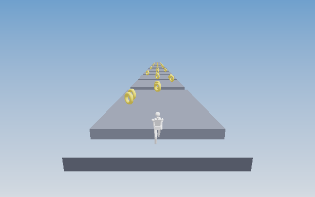
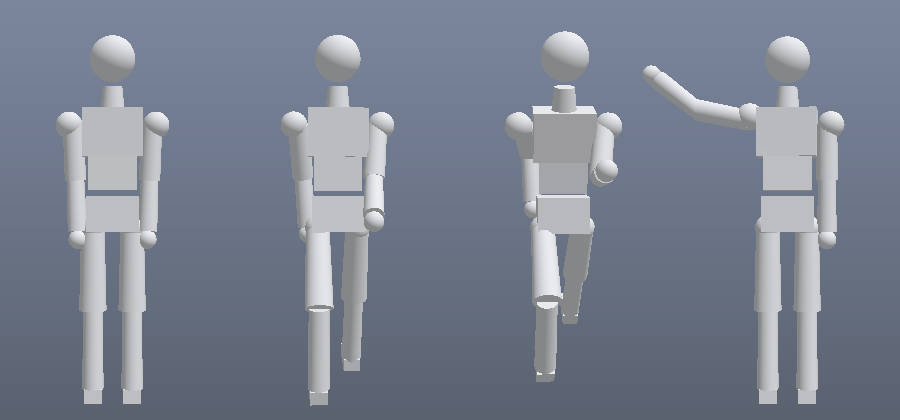

# Zorr3D

**一个零依赖的 WebGL2 轻量 3D 引擎，自带可视化编辑器、骨骼动画与一个能直接玩的跑酷游戏。**

全部渲染代码（PBR、阴影、泛光、雾、FXAA、蒙皮）都是自己实现，没有引入 three.js 之类的图形库。
产物是纯静态单文件 HTML，可以离线运行，同一份代码既能在桌面浏览器里编辑，也能打包成安卓 APK 在手机上跑。

| | 体积 | 说明 |
|---|---|---|
| 编辑器 | ~120 KB | 单文件，含引擎、UI、全部着色器 |
| 跑酷游戏 | ~83 KB | 单文件，含引擎与人形骨骼 |
| 安卓 APK | ~222 KB | WebView 外壳 + 三个页面，无运行时依赖 |



> 上图由仓库内的软件光栅化脚本 `tests/render.runner-preview.mjs` 生成，用于在无 GPU 环境下检查几何、相机与光照数据；浏览器实际画面在材质细节上会略有差异。



> 人形白模在待机 / 行走 / 奔跑 / 挥手四种动作下的姿势，由 `tests/render.preview.mjs` 生成。

## 它包含什么

### 引擎（`engine/`，与界面完全解耦）

- **渲染**：前向 PBR（Cook-Torrance GGX）、方向光阴影贴图、距离雾、半球环境光、HDR 泛光、ACES 色调映射、FXAA
- **几何**：程序化立方体/球体/圆柱/圆锥/圆环/平面，OBJ 与 glTF/GLB 解析，自动切线
- **骨骼**：层级骨骼、逆绑定矩阵、按"到骨骼线段距离"自动生成蒙皮权重
- **动画**：关键帧位置/旋转/缩放轨道、slerp、循环、淡入淡出、姿势快照
- **工具**：轨道相机、视锥剔除、射线拾取、场景序列化

### 编辑器（`web/editor/`）

层级树、属性面板、移动/旋转/缩放手柄（世界与局部坐标）、撤销重做、材质编辑、
glTF/OBJ 拖入导入、场景存取、角色动作切换与时间轴逐帧预览、骨架线框显示。

### 跑酷（`web/runner/`）

三车道第三人称跑酷。金币必须**全部**收集，终点门才会滑开；没集齐时门是实体墙，会挡住你并提示还差几枚。
玩家是同一套人形骨骼，跑动播放奔跑动作、起跳切换跳跃动作。

## 快速开始

```sh
git clone https://github.com/cswfwm/Zorr3D.git
cd Zorr3D

# 启动本地服务（同时提供编辑器、跑酷与保存接口）
sh start.sh 8770
# 打开 http://127.0.0.1:8770/dist/index.html
```

也可以直接双击 `dist/index.html`，无需任何服务端。

## 开发

```sh
# 单元测试：数学 / 几何 / 场景 / Gizmo / 关卡 / 骨骼 / 动画 / 蒙皮 / 着色器
node --test tests/*.test.mjs

# 用模拟 GL 跑通整条渲染管线
node tests/render.pipeline.mjs

# 重新生成 dist/ 下的三个单文件
node --version   # 需要 Node 18+
npm install --prefix /tmp/z3dbuild esbuild
python3 tools/build_dist.py
```

测试里的 `glslangValidator` 校验是可选的：装了就会对产物着色器做严格编译，没装会自动跳过。

## 安卓打包

```sh
python3 tools/build_dist.py
export JAVA_HOME=/path/to/jdk17
/opt/gradle-8.9/gradle-8.9/bin/gradle :app:assembleRelease --no-daemon
```

`minSdk 26 / targetSdk 34`，只用系统 WebView，不引入任何运行时依赖。

构建前需要：

1. 复制 `local.properties.example` 为 `local.properties`，填入本机 SDK 路径
2. JDK 17 与 Android SDK Platform 34

> 在 aarch64 + musl 的容器里构建时，还需要给 Gradle 追加
> `android.aapt2FromMavenOverride=<aapt2 路径>`，因为 SDK 自带的 aapt2 是 x86_64 二进制。

签名信息**不进仓库**。想产出签名包时，通过 `keystore.properties.example` 里的四个字段
（`RELEASE_STORE_FILE` / `RELEASE_STORE_PASSWORD` / `RELEASE_KEY_ALIAS` / `RELEASE_KEY_PASSWORD`）
以 Gradle 属性或环境变量传入；不配置则构建出 unsigned APK。

## 目录结构

```
engine/      引擎核心（不依赖 DOM，可在 Node 中直接测试）
web/editor/  可视化编辑器
web/runner/  跑酷游戏（level.js 是纯逻辑，可单测）
app/         安卓 WebView 外壳
tools/       本地服务、单文件打包、着色器导出
tests/       单元测试、渲染管线检查、软件光栅化预览
dist/        构建产物
```

## 调试技巧

- 界面里任何启动异常都会直接显示在屏幕上（真机上不用连电脑看日志）
- 安卓端 WebView 的 console 会打到 logcat：`adb logcat -s Zorr3D`
- `engine/gl.js` 编译着色器前会规范化源码并检查 `#version` 是否在首位

## 许可

MIT，见 [LICENSE](LICENSE)。
